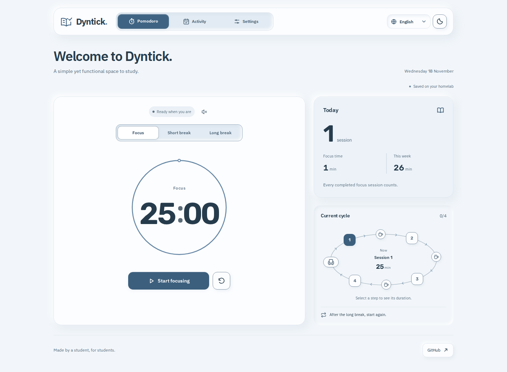
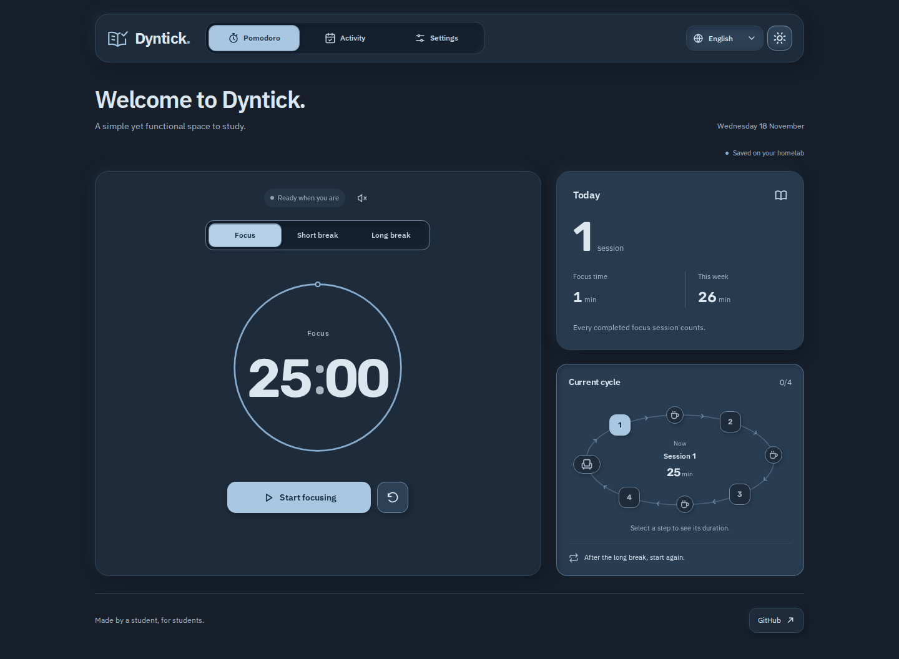

# Dyntick

A simple yet functional space to study.

Dyntick is a student-made study dashboard with a Pomodoro timer and an activity tracker.

Run it on your personal homelab and use the same timer, preferences and study history from your devices.



*Light theme · Dyntick 2.0.0.*



*Dark theme · Dyntick 2.0.0.*

## Install

Copy [compose.yaml](compose.yaml) into an empty folder on your server/homelab and run:

```sh
docker compose up -d
```

Open `http://SERVER_IP:8080`. Docker automatically pulls the ready-to-run public image.

To use a custom port, change the Compose port mapping to:

```yaml
ports:
  - "CUSTOM_PORT:8080"
```

Replace `CUSTOM_PORT` with the port you want to use, then open `http://SERVER_IP:CUSTOM_PORT`. The container continues listening on 8080.

Compose creates the named `dyntick-data` volume and mounts it at `/data`. The SQLite database is stored at `/data/dyntick.sqlite`. The application runs as the unprivileged Bun user, UID/GID `1000:1000`. Its root filesystem is read-only; the database volume and temporary directory remain writable.

## Upgrade from Dyntick 1.x

**Replace your old Compose file before starting version 2.0.0.** The 1.x Compose has a read-only filesystem and no database volume. Updating its image alone does not provide the persistent storage required by 2.0.0.

1. Keep a copy of your current Compose and replace it with the [new Compose](compose.yaml).
2. Keep the same project folder and your chosen host port, such as `"8090:8080"`.
3. Run `docker compose up -d --wait`.
4. Refresh Dyntick first in the original browser tab that holds the preferences and current timer you want to keep. Use the same address, protocol and port as before so that it can read its old browser storage.
5. Open the other browsers or devices that hold older study history to merge those records into the homelab database.

The first browser imports its saved preferences, timer and activity. Version 1.x kept the current timer in that tab's session storage, so a newly opened tab may recover preferences and history without recovering the old timer. Later browsers add their historical completions, including an earned completion recovered from an expired legacy timer, without replacing the live shared timer or preferences. Imports use stable session IDs to avoid duplicates. The old browser keys remain as a backup; a marker records each confirmed import for this installation.

Browser storage is tied to its original address. If the address or port has already changed, reopen the old address with the new application to import that browser's data. Dyntick cannot recover browser data that has been cleared or read storage from another device remotely.

## Your data and devices

Dyntick 2.0 is a single-user installation with one shared set of data. There are no accounts: every device that can reach the installation can see and change the same data. Use it on your trusted home network or through your existing private remote-access setup.

- Preferences, including language, theme, durations and sound, are saved in SQLite and shared between devices.
- The current timer is shared too. Starting, pausing, resuming, resetting or changing its mode on one device updates the others.
- Completed focus sessions are stored in the same database. Refreshing, changing browsers or clearing browser site data does not remove this history.
- The server records the timer's deadline. It recovers the current interval after a closed page, suspended device or container restart, without starting further intervals automatically.
- Changes are confirmed after the server saves them. If the homelab becomes unreachable, the interface keeps the last received state, disables changes and retries the connection. Concurrent changes from another device are shown before you retry an outdated action.

Connected pages refresh shared state regularly. The visual countdown follows the server's clock. The optional chime plays locally in each open browser and still requires that browser's audio permission; closing the page does not create a system notification.

The application, fonts and API are served from your own installation. There is no analytics or telemetry and no external application API is required. The footer opens this repository when you choose its link. Browser storage is used only to recover legacy 1.x data and remember that its import completed.

## Update, pin and stop

The default Compose follows the latest stable image. To update:

```sh
docker compose up -d --build --wait
```

The `--wait` option waits until the container is healthy. Updates happen when you run Compose; there is no background updater. Unchanged image layers are reused.

For a specific release:

```sh
DYNTICK_VERSION=2.0.0 docker compose up -d --build --wait
```

Use the pinned Compose attached to the release to keep that choice. Numbered source and image tags are immutable; `latest` follows the newest verified stable release.

Stop Dyntick with:

```sh
docker compose down
```

The database volume survives container recreation, normal updates and `docker compose down`. Start again from the same Compose project folder to reuse it. **Do not use `docker compose down -v` unless you intend to delete the saved data.** Keep a backup before future major upgrades or database changes. Version 1.x cannot use the 2.0 database.

## Back up the database

From the Compose folder, stop the service before copying its data, then start it again:

```sh
docker compose stop -t 30
docker compose cp dyntick:/data/. ./dyntick-backup
docker compose start
```

Use a new backup folder for each backup. Keep the complete copied folder, including any SQLite `-wal` or `-shm` files that are present, and store another copy outside the server.

To restore, keep Dyntick stopped while replacing its database files in the data volume. Restore a matching set of files; remove stale `-wal` and `-shm` files from the database being replaced. Preserve ownership `1000:1000` and restrictive file permissions so that the Bun user can access the restored data. Start the service only after the files and permissions are in place.

## Features

- Default 25-minute focus, 5-minute short break and 15-minute long break after four focus sessions.
- Configurable durations from 1 to 180 minutes and cycles of one to six focus sessions.
- Manual start for every next interval; background recovery completes only the interval that actually started.
- One shared timer, preferences and persistent activity history across devices using the same installation.
- An interactive oval cycle map, a daily activity calendar and separate Pomodoro, Activity and Settings pages.
- English initially, with saved optional Italian, German and Spanish. Switching language preserves active and paused timers.
- System, light and dark themes, reduced-motion support, IBM Plex Sans text and Rubik numerals.
- Left/right arrows or H/L switch pages outside fields and menus. Space starts or pauses the timer and R resets it when an interactive control does not have focus. Settings lists the shortcuts.

## Inspect and verify

| Area | Source |
| --- | --- |
| Main interface and navigation | [src/App.tsx](src/App.tsx), [src/StudyPages.tsx](src/StudyPages.tsx) |
| Shared client state and timer logic | [src/usePomodoro.ts](src/usePomodoro.ts), [src/timer.ts](src/timer.ts), [src/protocol.ts](src/protocol.ts) |
| Bun HTTP API and SQLite persistence | [server/app.ts](server/app.ts), [server/db.ts](server/db.ts), [server/index.ts](server/index.ts) |
| Legacy data import and activity records | [src/storage.ts](src/storage.ts), [src/activity.ts](src/activity.ts) |
| Locally generated sound | [src/audio.ts](src/audio.ts) |
| Translations | [src/i18n.ts](src/i18n.ts) |
| Container and persistent volume | [Dockerfile](Dockerfile), [compose.yaml](compose.yaml) |
| Dependency versions and lockfile | [package.json](package.json), [bun.lock](bun.lock) |
| Tests and build/release automation | [tests](tests), [.github/workflows](.github/workflows) |

The [Actions page](https://github.com/IlCandeDEV/dyntick/actions) exposes production build, browser, persistence, runtime, image privacy and vulnerability checks. The only uploaded release attachment is `compose.yaml`. The `runtime-image.json` audit record is stored in the `runtime-image-VERSION` artifact of the release's Actions run; it links the image digest to its public source commit and successful verification runs.

Runtime images carry public source, revision, version and license labels. Signed GitHub build attestations bind the published image digest to the public workflow. With the GitHub CLI, optional verification is:

```sh
gh attestation verify oci://ghcr.io/ilcandedev/dyntick-runtime:2.0.0 --repo IlCandeDEV/dyntick
```

Public source and automated checks make independent review possible; they do not establish that every potential defect has been found.

## Build and contribute

Dyntick uses TypeScript, React 19, Vite and Astryx Neutral for the interface. Bun 1.4.4 provides the build and test toolchain, HTTP runtime and built-in SQLite driver. Dependencies are pinned through `package.json` and the committed `bun.lock`. Official images contain the compiled interface, bundled API, runtime and license notices.

Run these development checks on a GitHub runner:

```sh
bun install --frozen-lockfile
bun run check
bun run test
bun run build
```

The production pipeline also runs Python distribution tests, container smoke checks, real-browser checks across independent devices, persistence checks and image scans on AMD64 and ARM64. Source tags point to the exact public commit used by the verified build. Official images are built only from its audited compiled artifact; users download the resulting image rather than compile the application on their PC or NAS.

Maintainers publish a release in this order:

1. Wait for **Verify Dyntick** on the intended `main` commit.
2. Run **Publish runtime image**, operation `publish`, with the version and successful CI run ID.
3. Run **Release Dyntick** with that CI run and successful image run. It verifies the artifact fingerprint and anonymous image access, publishes immutable source tags, the standard release description and pinned Compose, then advances `latest` and verifies public installation.

The release workflow archives `runtime-image.json` in Actions. To preserve a proof attached to an older release before removing that attachment, run **Archive runtime image proof** with its version. The original image proof and signed registry attestations remain available for verification.

Changes to runtime behavior should include focused tests. Keep dependency and font license notices with their files.

## License

Dyntick's application code, documentation and build scripts use the [PolyForm Noncommercial License 1.0.0](LICENSE). You can inspect the code and use, modify and redistribute it for the purposes permitted by that license, including personal study and qualifying noncommercial uses. Commercial use outside those permitted purposes requires separate permission from the copyright holder.

This is a **source-available, noncommercial project**. It is not offered under an OSI-approved open-source license. Dependencies and fonts retain their own licenses; the application license does not replace their terms. Font notices are included in [public/fonts](public/fonts).
