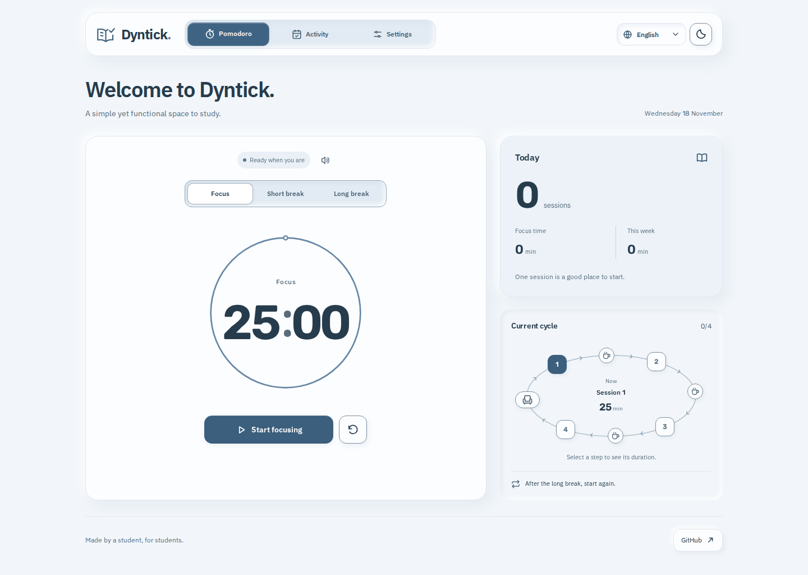
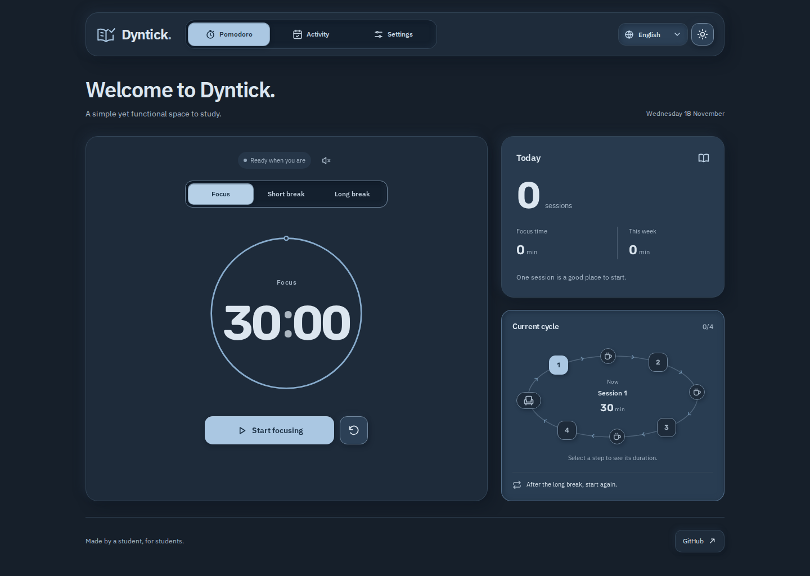

# Dyntick

A simple yet functional space to study.

Dyntick is a student-made study dashboard with a Pomodoro timer and an activity tracker.



*Light theme · Dyntick 1.5.0.*



*Dark theme · Dyntick 1.5.0.*

## Install

Copy [compose.yaml](compose.yaml) into an empty folder on your server/homelab and run:

```sh
docker compose up -d
```

Open `http://SERVER_IP:8080`. Docker automatically pulls the ready-to-run public image.

To use a custom port, change the Compose port mapping to `"CUSTOM_PORT:8080"`.

## Update and pin a version

The default Compose follows the latest stable release. Run the same command to check for an update:

```sh
docker compose up -d --build --wait
```

The `--wait` part makes the service wait until the container is healthy.

To install a specific release just specify the version before running the docker compose command.
For example to use the 1.5.0:
```sh
DYNTICK_VERSION=1.5.0 docker compose up -d --build --wait
```

Prebuilt images are available from 1.5.0. Older release attachments retain their original installation method. To migrate an older Compose, replace its image with `ghcr.io/ilcandedev/dyntick-runtime:${DYNTICK_VERSION:-latest}`, set `pull_policy: always`, and remove its entire `build` section. Keep your chosen host port.

Stop Dyntick with `docker compose down`. Browser preferences and study history are preserved when the address, protocol and port stay the same.

## What runs in your browser

Dyntick serves its JavaScript, styles and fonts from your installation. The chime is generated locally through browser audio. The application has no account system, database, analytics or telemetry, and makes no automatic requests to an external application API. The footer opens this repository when you choose its link.

- Preferences, including theme and language, use browser `localStorage`.
- Each tab's current timer uses `sessionStorage`, survives refresh and stays independent from other tabs.
- Completed focus sessions use `localStorage` under `dyntick.activity.v1`. Tabs on the same origin merge their records without duplicating a recovered session.
- Clearing browser site data removes the saved preferences and history. A different browser, host, protocol or port has separate storage.
- Closing a tab does not send a system notification. Sound requires the page to remain open and browser audio to be enabled.

The server stores no study history. Installing or updating its container does not transfer browser data between devices.

## Inspect and verify

Start with these files:

| Area | Source |
| --- | --- |
| Main interface and navigation | [src/App.tsx](src/App.tsx), [src/StudyPages.tsx](src/StudyPages.tsx) |
| Timer state and recovery | [src/timer.ts](src/timer.ts), [src/usePomodoro.ts](src/usePomodoro.ts) |
| Browser storage and activity records | [src/storage.ts](src/storage.ts), [src/activity.ts](src/activity.ts) |
| Locally generated sound | [src/audio.ts](src/audio.ts) |
| Translations | [src/i18n.ts](src/i18n.ts) |
| Web server and container restrictions | [deploy/nginx.conf](deploy/nginx.conf), [Dockerfile](Dockerfile), [compose.yaml](compose.yaml) |
| Exact frontend dependency resolution | [deno.lock](deno.lock) |
| Tests and build/release automation | [tests](tests), [.github/workflows](.github/workflows) |

The [Actions page](https://github.com/IlCandeDEV/dyntick/actions) exposes production build, browser, runtime, image privacy and vulnerability checks. Each release includes a `runtime-image.json` file linking its image digest to its source commit and successful verification runs.

Runtime images carry public source, revision, version and license labels. Signed GitHub build attestations bind the published image digest to the public workflow. With the GitHub CLI, an optional verification is:

```sh
gh attestation verify oci://ghcr.io/ilcandedev/dyntick-runtime:1.5.0 --repo IlCandeDEV/dyntick
```

Public source and automated checks make independent review possible; they do not establish that every potential defect has been found.

## Features

- Default 25-minute focus, 5-minute short break and 15-minute long break after four focus sessions.
- Configurable durations from 1 to 180 minutes and cycles of one to six focus sessions.
- Manual start for every next interval; leaving the page in the background completes only the interval that actually started.
- An interactive oval cycle map, a daily activity calendar and separate Pomodoro, Activity and Settings pages.
- English initially, with saved optional Italian, German and Spanish. Switching language preserves active and paused timers.
- System, light and dark themes, reduced-motion support, IBM Plex Sans text and Rubik numerals.
- Left/right arrows or H/L switch pages outside fields and menus. Space starts or pauses the timer and R resets it when an interactive control does not have focus. Settings lists the shortcuts.

## Build and contribute

The frontend uses TypeScript, React, Vite, Deno 2.9.8 and Astryx Neutral. Dependencies are resolved through the committed lockfile. A source build can be inspected in [Dockerfile](Dockerfile); frontend compilation and Alpine security updates happen on GitHub runners for official images.

Development checks are:

```sh
deno install --frozen --allow-scripts=npm:esbuild
deno task check
deno task test
deno task build
```

The production pipeline also runs Python distribution tests, container smoke checks, real-browser tests, and runtime scans on AMD64 and ARM64. Source tags point to the exact public commit used by the verified build. Official images are built only from its audited compiled artifact.

Maintainers publish a release in this order:

1. Wait for **Verify Dyntick** on the intended `main` commit.
2. Run **Publish runtime image**, operation `publish`, with the version and successful CI run ID.
3. Run **Release Dyntick** with that CI run and successful image run. It verifies the artifact fingerprint and anonymous image access, publishes immutable source tags, the standard release description and pinned Compose, then advances `latest` and verifies public installation.

Changes to runtime behavior should include focused tests. Keep dependency and font license notices with their files.

## License

Dyntick's application code, documentation and build scripts use the [PolyForm Noncommercial License 1.0.0](LICENSE). You can inspect the code and use, modify and redistribute it for the purposes permitted by that license, including personal study and qualifying noncommercial uses. Commercial use outside those permitted purposes requires a separate permission from the copyright holder.

This is a **source-available, noncommercial project**. It is not offered under an OSI-approved open-source license. Dependencies and fonts retain their own licenses; the application license does not replace their terms. Font notices are included in [public/fonts](public/fonts).
